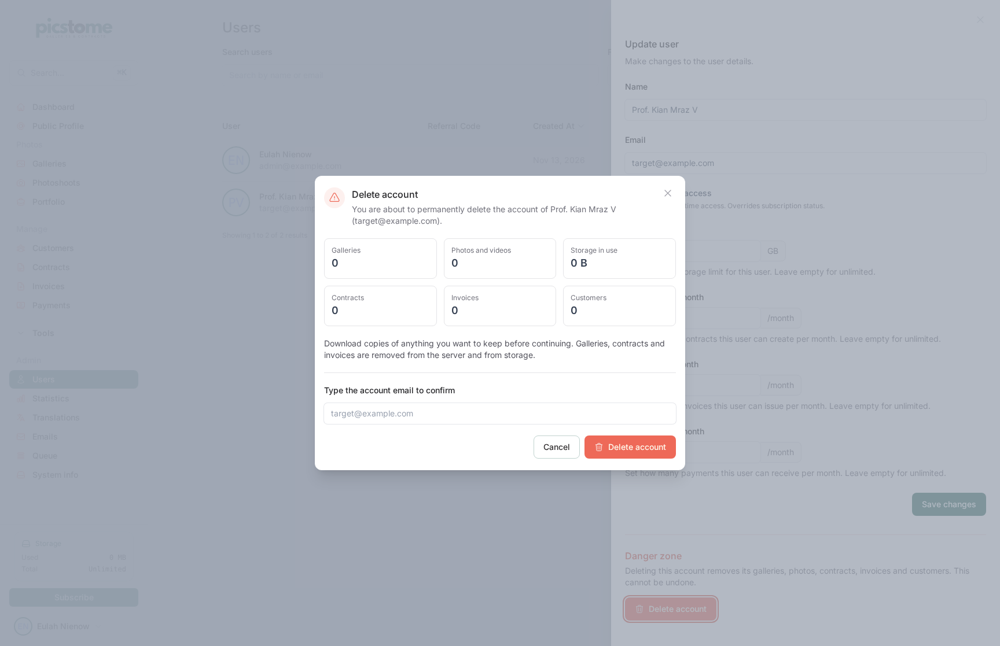

# Account deletion

Closing an account is irreversible. This document describes what is removed,
in which order, and what can go wrong.

## Entry points

| Where | Who | Confirmation |
|---|---|---|
| `/settings/profile` (bottom right, coral button) | the owner | current password **and** typing the account email |
| `/settings/password` (Danger zone, under the tokens) | the owner | current password **and** typing the account email |
| `/users` → edit user → Danger zone | admins only | typing the target's email |

All three render the same component,
`resources/views/components/⚡delete-account-modal.blade.php`. With no `user`
prop it targets the authenticated account; with one it requires
`is_admin` and refuses to act on the admin's own account (that path falls back
to the password confirmation).

The modal shows the inventory first — galleries, photos and videos, storage in
use, contracts, invoices, customers — plus the consequences: subscriptions are
cancelled **immediately without a refund**, issued invoices are the user's
fiscal records, camera upload credentials stop working, connected apps lose
access.

Password checks are throttled to five attempts per five minutes per
actor/target pair (`RateLimiter` in the component). A stolen session can
therefore not brute force the password.

## Two phases

Deletion happens in two steps on purpose:

1. **Synchronous, in the Livewire action** — `AccountDeletionService::revokeAccess()`
   deletes the user's Sanctum tokens and every other session, then logs the
   browser out and redirects to `/login` with a `status` flash. The purge job is
   dispatched in the same request.
2. **Queued** — `App\Jobs\PurgeUserAccount` (tries = 3, timeout = 3600s) runs
   `AccountDeletionService::purge()`.

The split exists because a photographer with tens of thousands of photos cannot
be deleted inside an HTTP request. The synchronous part closes the window where
the job is still queued but the user is still signed in.

## Purge order

Per owned team (`AccountDeletionService::purge()`):

1. Snapshot the **disk + directory** pairs that can hold the team's files,
   before any row is deleted:
   - every photo's `disk` and the directories of its `path`, `raw_path` and
     `thumb_path`;
   - every version's own `disk` and paths — versions can live on a different
     disk than their photo;
   - `teams/{id}` on the configured disk (brand assets, contracts,
     signatures, invoice PDFs);
   - `teams/{id}` on every disk used by the team's gallery archives.

   The parent directory is resolved by walking back to the `teams/{id}`
   segment, so an imported library stored under a foreign root
   (`docs-demo/teams/8/...`) is removed too instead of being left behind. The
   segment boundary is enforced (`teams/7` does not match `teams/70`), and a
   path with no team segment is deleted **file by file** — never through its
   parent directory, which may be shared with other teams.
2. Cancel Stripe subscriptions with `cancelNow()` (best-effort, reported).
   The Stripe customer is **kept**: only the subscription is cancelled. Cashier
   uses the **platform** key (`cashier.secret`), never the team's Connect key.
3. Delete the SFTPGo user, purge the camera inbox (`camera-uploads/{username}`),
   delete the inbox directory, then the local `ftp_accounts` row.
4. `Team::deleteAllResources()`:
   - brand assets, contracts (+ signatures, PDFs, signature images),
     contract templates;
   - invoices, `invoice_events`, invoice settings, customers, payments (mass
     deletes — see below);
   - galleries with their photos and versions, photoshoots, bio links,
     calculator state;
   - the `teams/{id}` directory on the default disk.
5. Delete every captured directory, per disk.
6. Delete Cashier subscriptions and subscription items (no FK to `teams`).
7. Delete the team.

Then, once:

- the avatar file and `users` row,
- `personal_access_tokens`, `external_authorizations`,
- `sessions` and `password_reset_tokens` for the email,
- an `App\Jobs\RemoveFromAcumbamailList` job (both language lists).

## Verified end to end

An audit against the real schema (every table with a `user_id`/`team_id`, and
every FK rule) confirmed that after a purge of an account holding galleries,
photos, versions, comments, archive ZIPs, contracts, templates, customers,
issued invoices, invoice events, settings, payments, photoshoots, FTP account,
tokens and sessions, every one of those rows is gone and every stored object on
every referenced disk is removed. The regression tests in
`tests/Feature/AccountDeletionServiceTest.php` pin the bugs the audit found:
versions on a second disk, libraries stored outside `teams/{id}`, the
`teams/70` vs `teams/7` prefix collision, and paths that would have resolved to
the bucket root.

## Why mass deletes for invoices

`Invoice` and `InvoiceEvent` throw a `LogicException` when deleted through the
model: issued invoices are immutable and the audit trail is append-only. The
account-closure path deliberately bypasses those guards with query-builder
deletes, because the whole point of the flow is that the owner has been warned
that closing the account destroys its fiscal records. `docs/invoicing.md`
(§ Retention) documents the legal consequences.

## Why no per-file deletion jobs

Normal gallery deletion dispatches one `DeleteFromDisk` job per file so shared
paths are respected. The closure path removes whole directories instead, and
dispatching hundreds of thousands of storage requests for a large library would
keep a worker busy for hours for no benefit. The only per-file deletes are the
paths that carry no `teams/{id}` segment, because their parent directory cannot
be assumed to belong to this account.

## Failure handling

Every external call is wrapped so a failure never blocks the deletion:

- Stripe (subscription cancel) — logged and `report()`ed, then the local rows
  are still removed.
- SFTPGo (`deleteUser`) and the FTP inbox — same.
- Storage directory deletion — same, per disk.

All of them write a `warning` to the log with `Log::warning` and `report()`, so
Honeybadger shows them and the leftovers can be removed by hand. The remaining
database work is not wrapped. The purge restarts from the current database
state, so the job retries twice with backoff before `failed()` reports the
exception.

## External services

- **Stripe**: `Subscription::cancelNow()` with the platform key
  (`cashier.secret`). The team's own Connect key is for charging *their*
  clients and is deliberately not used here.
- **Acumbamail**: `RemoveFromAcumbamailList` POSTs to
  `https://acumbamail.com/api/1/deleteSubscriber/` with `auth_token`,
  `list_id` and `email`, once per configured list (`list_id` and
  `list_id_es`). A missing token makes it a no-op, and a failed request is
  ignored because the local account is already gone.
- **SFTPGo**: `deleteUser()` through the admin API, then the inbox files.

## Not covered

- The queue worker must be running; otherwise the account is locked out but the
  data stays until the job runs.
- Files with no recognizable `teams/{id}` segment are deleted individually; an
  object that no row points to at all cannot be found and is not removed.
- Backups, CDN caches and Stripe records (customer, payment methods, invoices)
  are not purged; the subscription is cancelled, nothing else is touched in
  Stripe.
- The queue worker must process the job; if it is stopped the account is locked
  out but its data stays until the job runs.
